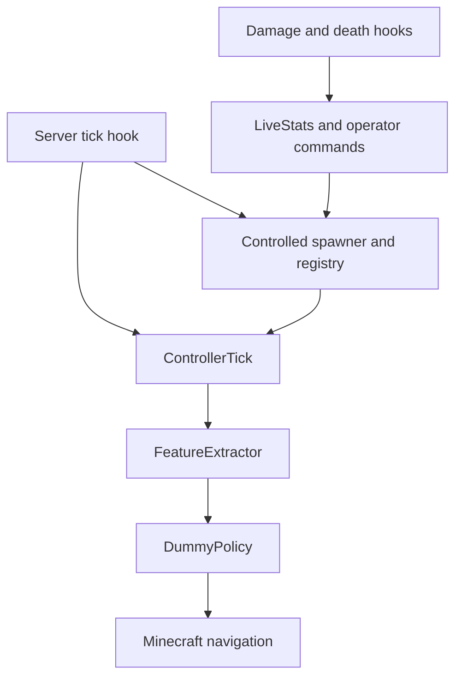
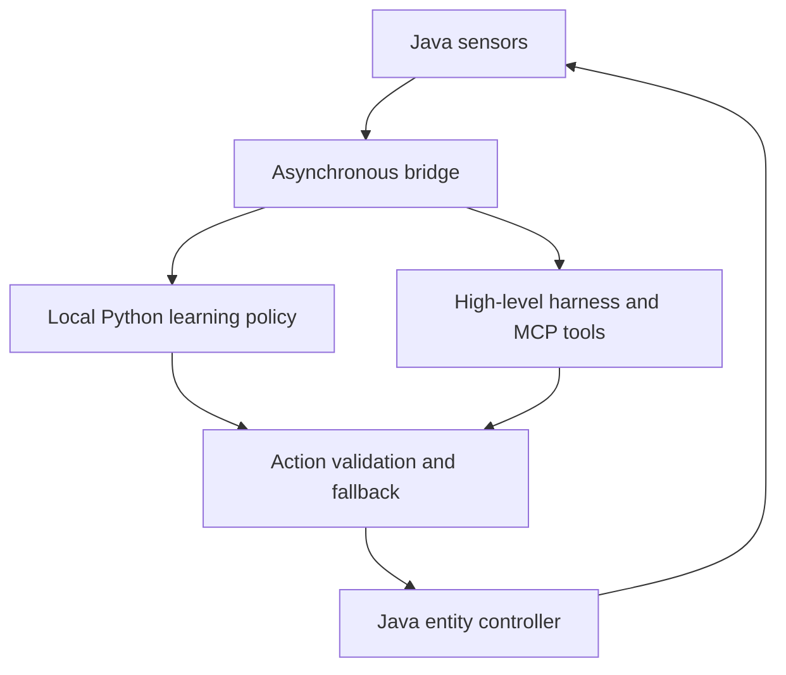

# 🧠 AutoMob — Adaptive Multi-Agent AI Sandbox & Decision Harness

[](https://fabricmc.net/)
[](https://fabricmc.net/)
[](LICENSE.txt)
[](#project-status)

**AutoMob** is an open-source, server-side Minecraft prototype exploring adaptive mob AI and real-time decision harnesses. Built with **Fabric 1.21.4 and Java 21**, it provides early foundations for observing entities, selecting actions and collecting combat-related signals.

The research direction is to turn Minecraft into an accessible **multi-agent testbed**: compare local policies, study combat and evasion, and evaluate coordination under server tick constraints. A modular **Agent Harness** would connect those experiments to external learning backends and optional **Model Context Protocol (MCP)** supervision.

## Project status

**Experimental prototype — not yet a validated learning system or ready-to-install mod.** The current implementation uses `DummyPolicy`, which moves mobs toward a nearby player with small random perturbations. Learned combat, adaptive evasion, swarm coordination, the external harness and MCP integration remain roadmap items. Attacks and shooting are not yet wired into the policy controller.

## What exists today

| Component | Current implementation |
| --- | --- |
| Controlled entities | Skeleton spawning around players in the Overworld and a registry of controlled mob IDs. |
| Spawn pressure | A rule adjusts the desired local mob count using the prototype damage statistic. |
| Sensors | A 16-value feature vector covering relative direction and distance, velocities, health, relative yaw and offsets. |
| Policy interface | `Policy` and `Action` separate action selection from movement application; `DummyPolicy` is the only implementation. |
| Movement | `ControllerTick` sends movement requests through Minecraft's pathfinder. |
| Combat signals | Hooks track damage attempts and kills attributed to registered mobs, plus controlled-mob deaths. |
| Operator commands | `/neuro stats` displays local metrics; `/neuro reset` clears those counters. Both require permission level 2. |

The reward statistics are experimental: damage is observed before application through `ALLOW_DAMAGE`, and RPM/DPM are event-based estimates rather than validated rolling per-minute measurements. These signals do not currently train a model.

## Architecture

### Current Java/Fabric prototype



All current policy calls run locally on the server thread.

### Planned harness integration



The intended split is between frequent local control decisions and slower strategic supervision. A future LLM coordinator would inspect snapshots or propose bounded directives outside the tick loop. Minecraft's main thread must never wait for a model response.

Design targets:

- **Bounded execution:** validate actions, limit queues and discard stale decisions. At 20 TPS, the whole server tick has approximately 50 ms; this is not a budget reserved for AutoMob or a measured performance guarantee.
- **Local learning:** explore a Python/PyTorch PPO backend over asynchronous gRPC/Protobuf, with explicit transitions and rewards attributed to each agent.
- **Harness interoperability:** add structured telemetry and a JSON/WebSocket interface for inspection, replay and external orchestration.
- **MCP supervision:** expose selected world state, experiment settings and bounded strategic directives through an optional MCP server.
- **Graceful degradation:** implement vanilla fallback when the backend is unavailable, responses are stale or server TPS falls below the configured threshold.
- **Reproducible evaluation:** record seeds, policy versions, latency distributions and task outcomes. Deterministic action validation is a design goal, not a claim that the Minecraft simulation or current randomized policy is deterministic.

## Hardware target

The planned local learning backend targets a **GeForce RTX 2080 as the minimum reference GPU**. Model size, batch size, agent count and memory usage will be benchmarked on that hardware before publishing performance claims.

The current Java prototype does not use CUDA or require a GPU for inference. Training and checkpoint persistence are future backend work.

## Roadmap

Checked items describe code present in the repository, not end-to-end validation.

- [x] Fabric server tick hooks, controlled spawning and mob registry.
- [x] Gameplay feature extraction and a local policy abstraction.
- [x] Placeholder movement policy and navigation application.
- [x] Initial combat statistics and operator commands.
- [ ] Re-establish a reproducible build and server smoke test.
- [ ] Correct reward accounting, time-based metrics and registry lifecycle handling.
- [ ] Connect policy-driven attacks; implement and evaluate combat spacing and evasion.
- [ ] Add asynchronous Java/Python communication, bounded action validation and vanilla fallback.
- [ ] Implement PPO training, checkpoint persistence and RTX 2080 benchmarks.
- [ ] Add structured JSON/WebSocket telemetry for external Agent Harnesses.
- [ ] Build an optional MCP server for world-state inspection and tactical supervision.
- [ ] Implement and evaluate shared threat state, flanking and coordinated retreats.
- [ ] Publish a benchmark suite comparing latency, resource usage and tactical outcomes against baseline policies.

## Installation and development

### Prerequisites

- **JDK 21** and Git.
- **Minecraft 1.21.4**, **Fabric Loader 0.17.3** and **Fabric API 0.119.4+1.21.4** for the target server.
- The Gradle wrapper is included; dependency versions are defined in `gradle.properties`.

### Build from source

```bash
git clone https://github.com/leocorv/AutoMob.git
cd AutoMob
bash ./gradlew build
```

On Windows PowerShell, use `./gradlew.bat build` after cloning and entering the repository.

A successful build writes the mod JAR to `build/libs/`. For an experimental deployment, place the main mod JAR and the matching Fabric API JAR in the Fabric server's `mods/` directory. AutoMob is server-side; clients do not need to install it.

For a development server, use `bash ./gradlew runServer` (or `./gradlew.bat runServer` on Windows) and follow Minecraft's EULA prompt. Build and gameplay validation still need to be completed; use a disposable test world.

### Source map

| File | Responsibility |
| --- | --- |
| [Automob.java](src/main/java/org/nerix/automob/Automob.java) | Registers tick, command and combat-event hooks. |
| [ControlledSpawner.java](src/main/java/org/nerix/automob/ControlledSpawner.java) | Spawn placement and rule-based mob count. |
| [ControlledMobRegistry.java](src/main/java/org/nerix/automob/ControlledMobRegistry.java) | Tracks controlled mob identifiers. |
| [FeatureExtractor.java](src/main/java/org/nerix/automob/FeatureExtractor.java) | Selects a target and constructs observations. |
| [Policy.java](src/main/java/org/nerix/automob/Policy.java), [Action.java](src/main/java/org/nerix/automob/Action.java), [DummyPolicy.java](src/main/java/org/nerix/automob/DummyPolicy.java) | Policy contract, action representation and placeholder policy. |
| [ControllerTick.java](src/main/java/org/nerix/automob/ControllerTick.java) | Applies movement decisions. |
| [DamageHooks.java](src/main/java/org/nerix/automob/DamageHooks.java), [LiveStats.java](src/main/java/org/nerix/automob/LiveStats.java), [NeuroCommands.java](src/main/java/org/nerix/automob/NeuroCommands.java) | Experimental combat signals and operator feedback. |

## Contributing

Contributions are welcome around build reproducibility, telemetry correctness, bounded asynchronous control and benchmark design. Please distinguish measured results from intended behavior and include reproducible steps for bug reports and performance claims.

## License

AutoMob's source code is released under the [MIT License](LICENSE.txt). Minecraft and third-party dependencies remain subject to their own licenses and terms.

Created by **[Léo Corvaisier-Palluy (Nerix / leocorv)](https://github.com/leocorv)**.
